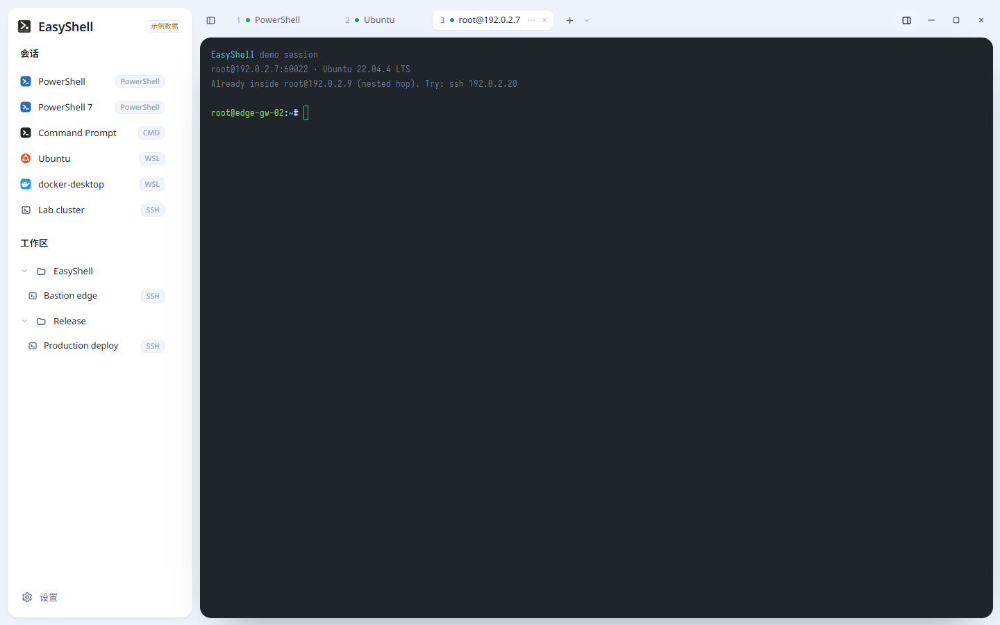
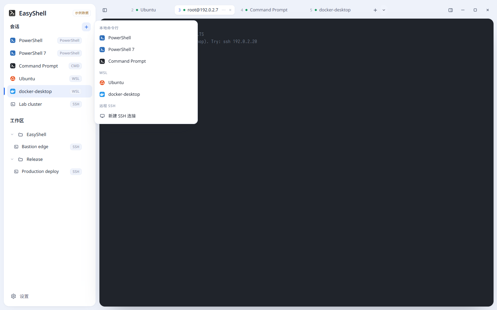
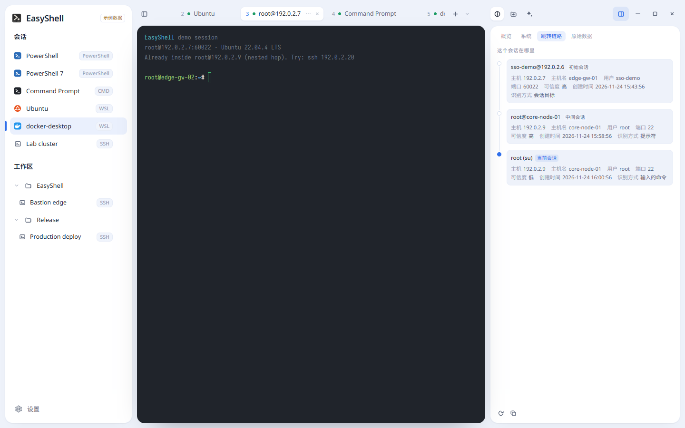
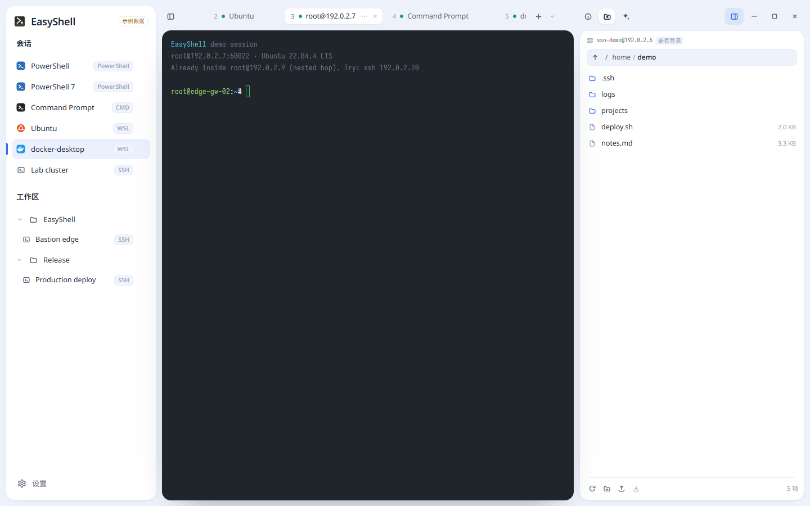
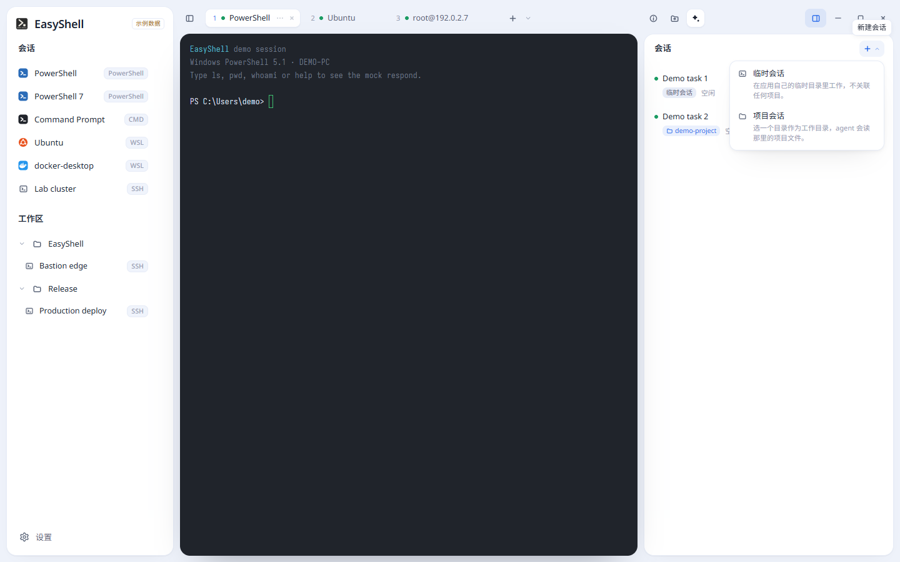
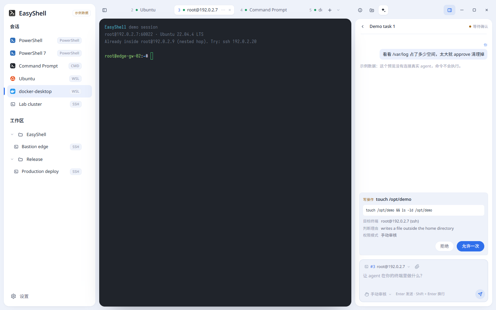

<h1 align="center">
  EasyShell
</h1>

<p align="center">
  A cross-platform desktop terminal for local development and remote operations
</p>

<p align="center">
  Manage local shells, WSL and SSH sessions in one window, follow nested logins, and automate terminal work through an ACP agent and a local API.
</p>

<p align="center">
  <b>English</b> · <a href="README.md">简体中文</a>
  &nbsp;|&nbsp;
  <a href="https://github.com/omioc/easyshell/releases">Downloads and builds</a>
</p>

---

## About EasyShell

EasyShell is a desktop terminal for Windows, macOS and Linux. It puts local command lines, Windows Subsystem for Linux (WSL) and SSH into a single set of tabs and a single connection list: the sidebar keeps and organises the entry points, the tabs show the sessions that are actually running.

The Electron main process hosts the shell and SSH sessions; the terminal UI presents input and output. On top of that, EasyShell offers a local control API, a command-line client and an optional ACP agent panel, so scripts and AI agents can drive the terminal under a permission gate.

**Built for:** people who switch between servers, log in hop by hop through a bastion, keep SSH hosts for different projects side by side — and developers or operators who want a local script or an agent to work the terminal for them.

## Screenshots

These screenshots come from the app's own interface (`npm run dev:web`); the terminal output and host details in them are the built-in demo data.

<table>
  <tr>
    <td align="center" width="33%">
      <br />
      <sub><b>Main window</b> · inventory, tab strip and terminal</sub>
    </td>
    <td align="center" width="33%">
      <br />
      <sub><b>New session</b> · the new-session menu of the sessions list</sub>
    </td>
    <td align="center" width="33%">
      <br />
      <sub><b>Hop chain</b> · initial / intermediate / current login</sub>
    </td>
  </tr>
  <tr>
    <td align="center" width="33%">
      <br />
      <sub><b>SFTP files</b> · the tab's host, following the session's current directory</sub>
    </td>
    <td align="center" width="33%">
      <br />
      <sub><b>Session list</b> · a new session is either temporary or a project session</sub>
    </td>
    <td align="center" width="33%">
      <br />
      <sub><b>Conversation</b> · the agent conversation, the approval card and the permission mode</sub>
    </td>
  </tr>
</table>

## Features

### Several kinds of session, one window

- **Local shells:** Windows ships PowerShell, PowerShell 7 and Command Prompt; macOS and Linux ship zsh, bash and sh. Shell profiles are editable in settings.
- **WSL:** see the distributions installed on Windows and open one as its own session.
- **SSH:** in-app SSH connections with password, private key, SSH agent and keyboard-interactive authentication; connections can be saved and grouped into workspaces.
- **Inventory and tabs are separate:** the connection list holds launchers, the tabs at the top hold running sessions. Reorder sessions, drag an SSH host into another workspace, and keep several tabs open at once.

### Following the SSH hop chain

After connecting to a host, logging in somewhere else from that shell makes EasyShell combine the typed command line, terminal titles, login banners and prompts into an updated hop chain for the session, along with the host it is really on. Metadata probing prefers a separate channel or a hidden probe command, so probe text stays out of the terminal output.

Detection depends on the remote shell, the login prompts and the network, so no custom bastion scheme is guaranteed to be recognised. It exists to help you understand where a session is; it never replaces the SSH client's own security checks.

### Session file panel

The file panel in the sidebar browses the files of the local, WSL or SSH session the tab is on. Files and folders can be created, renamed, deleted, uploaded, downloaded and dragged around; SSH operations go over SFTP. For a detected nested login the panel stays on the machine the tab was opened on — it does not pretend to sit at the end of the hop chain.

### Optional ACP agent

EasyShell can connect to an Agent Client Protocol (ACP) compatible agent CLI installed on the machine. The feature is off by default: enable it in settings and configure the agent command first. Agent tasks run independently of terminal tabs and reach EasyShell's sessions through the built-in MCP bridge tools; the panel shows the conversation, the state of each command call and any approval waiting for you.

The permission mode can be switched inside a session:

- **Read-only:** commands that observe state are allowed; writes and destructive commands are blocked.
- **Ask:** read commands run immediately, everything else waits for your approval.
- **Auto:** ordinary write commands run immediately; destructive commands, or ones that cannot be classified, wait for approval.
- **Unrestricted:** no approval gate is added to agent commands.

Agent execution is not an operating-system-level sandbox. Classification and approval do not replace backups, least-privilege accounts or a human reading the command; connect only agents you trust, and check what will run before a high-impact operation.

### Local API and command-line client

EasyShell serves an HTTP and WebSocket control API bound to `127.0.0.1`, so local scripts or agents can inspect and drive sessions. The API is authenticated with a bearer token and ships with a command-line client covering `ls`, `info`, `probe`, `input` and `exec`. The default port is `37821`; the API switch, the port and the token are configurable in settings.

The API is for the local machine only. Do not expose it to the internet or hand it to an untrusted process, and keep the token safe if you automate with it.

### Connection management and personalisation

- Collect saved SSH connections into named workspaces, and drag a host back to the ungrouped list.
- Configure the SSH host-key policy, the default port and keepalive.
- Choose from several UI and terminal colour schemes, and set the terminal font, size, cursor and window layout.
- Command-line launch parsing and a configurable copy of the application identity metadata, for specific bastion compatibility cases. The identity feature only rewrites file information in the generated copy: it adds no digital signature and bypasses no network audit or access control. Check your organisation's rules before using it.

## Platforms and packaging

The project is built on Electron, React, TypeScript and xterm.js. The source configures these distribution targets:

- **Windows x64:** NSIS installer, portable build and ZIP.
- **macOS:** DMG.
- **Linux:** AppImage and deb.
- **WSL:** WSL distribution sessions are available on Windows only.

Check the [GitHub Releases](https://github.com/omioc/easyshell/releases) page for downloadable builds; if there is none for your platform, run or build from source as described below.

## Running from source

Node.js and npm are required. Clone the repository, then from the project root:

```bash
git clone https://github.com/omioc/easyshell.git
cd easyshell
npm install
npm run dev
```

`npm run dev` starts the Electron app together with the development build. To look at the renderer in a browser only:

```bash
npm run dev:web
```

The browser preview uses the in-memory mock bridge: it reaches no real local terminal and no SSH session. The default address is `http://localhost:5273`.

### Common development commands

```bash
npm run build       # build the main process, the preload script and the renderer
npm run typecheck   # type-check the main process and the web side
npm test            # run the Vitest unit tests
npm run e2e         # build, then run the Electron smoke test
```

More end-to-end and packaging commands live in `package.json` at the project root: for example `npm run e2e:ssh`, `npm run e2e:deep`, `npm run dist:win`, `npm run dist:mac` and `npm run dist:linux`. `e2e:deep` needs a usable WSL distribution; what each packaging target requires is described in the Electron Builder documentation and by your platform's toolchain.

## Security and credentials

The local control API binds to the loopback address `127.0.0.1`, and every request needs a bearer token. A token is generated when the settings file is first created and can be regenerated in the settings UI. Never put the token into public scripts, logs or an untrusted agent's configuration.

SSH passwords and private-key passphrases are encrypted with Electron `safeStorage` when the system key store is available. On a Linux system without a usable keyring the app still works, but those values stay in the user's configuration file in plain text. Check the keyring state of the machine and protect the user configuration directory.

SSH host-key verification defaults to `accept-new`: the host key is accepted on the first connection, and a later change is reported and updated. Strict and no-verification modes are selectable in settings. Environments that need a strong authentication guarantee should use the strict policy and compare the fingerprint before approving a host key.

## Contributing

Problems and suggestions are welcome on [Issues](https://github.com/omioc/easyshell/issues), and pull requests are welcome too. When reporting a problem, please include the EasyShell version, the operating system, the session kind, the steps to reproduce and the relevant error. Logs and configuration can contain host addresses, user names, paths or credentials — check them and remove anything sensitive before posting.

Run `npm run typecheck` and `npm test` before sending code, and run the relevant end-to-end tests for changes that touch an application flow. A pull request should say what changed, how it was verified, and what is not covered yet.

## License

EasyShell is open source under the [MIT License](LICENSE). Keep the licence notice when you use, modify or distribute the project.
