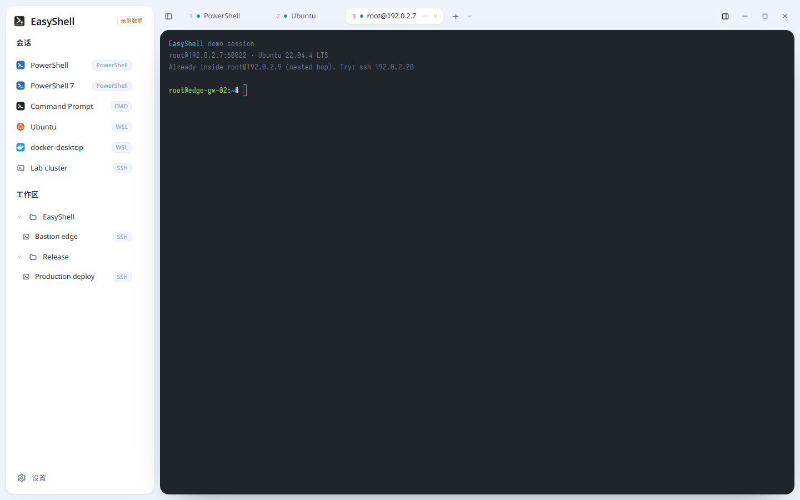
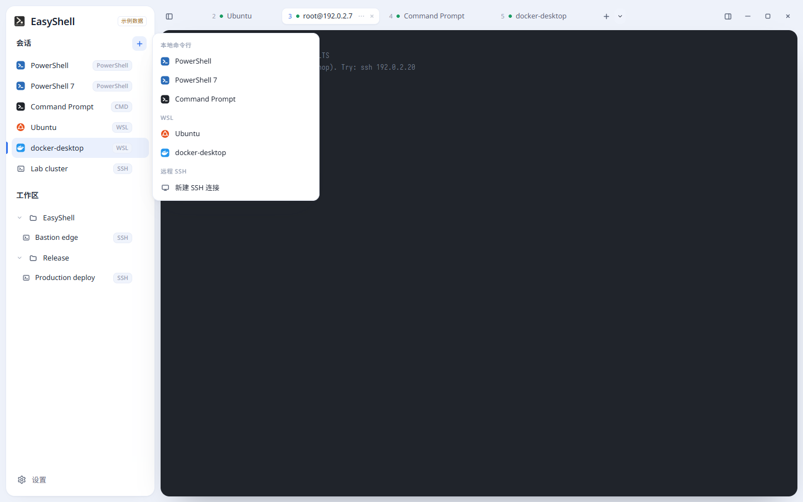
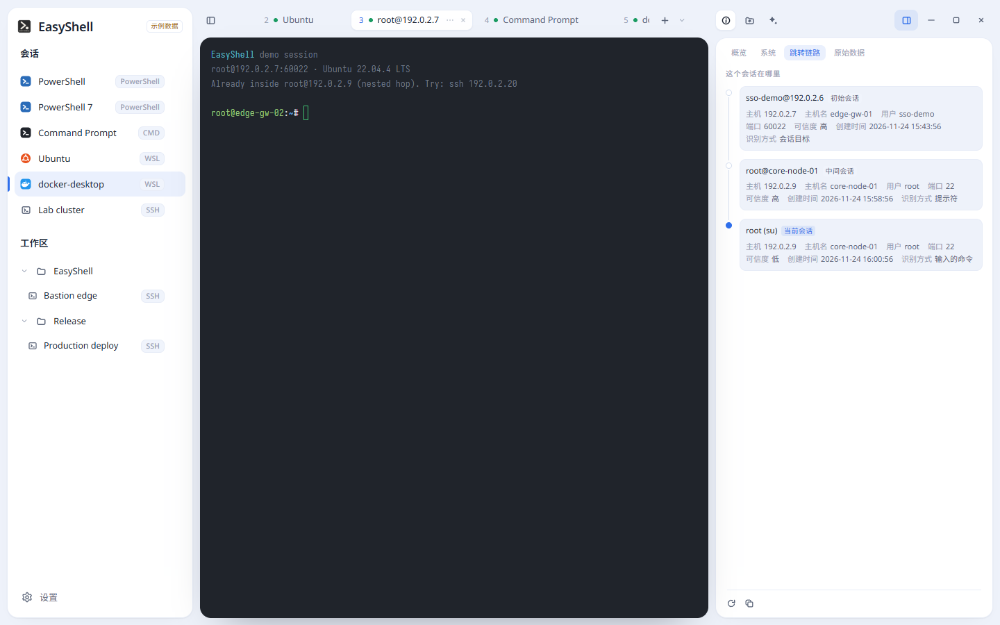
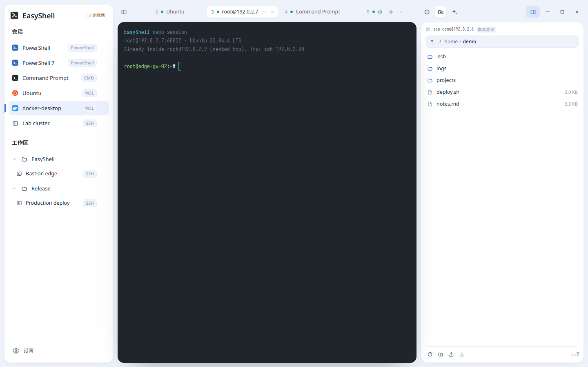
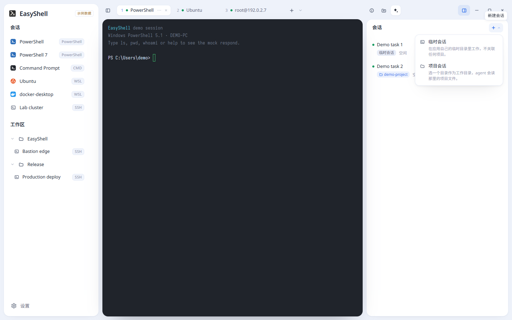
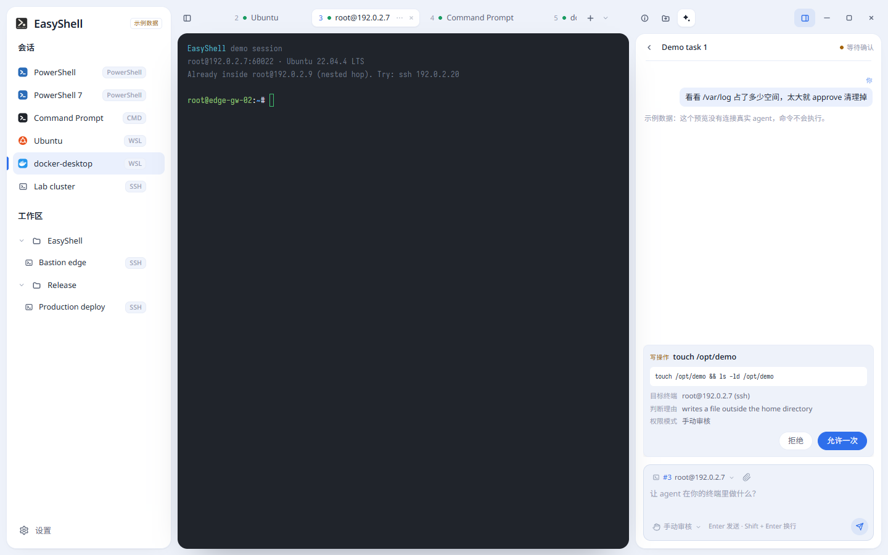

<h1 align="center">
  EasyShell
</h1>

<p align="center">
  面向本地开发与远程运维的跨平台桌面终端
</p>

<p align="center">
  在一个窗口里管理本地 Shell、WSL 与 SSH 会话，跟踪嵌套跳转，并可通过 ACP Agent 和本地 API 自动化终端工作流。
</p>

<p align="center">
  <a href="README.en.md">English</a> · <b>简体中文</b>
  &nbsp;|&nbsp;
  <a href="https://github.com/omioc/easyshell/releases">下载与版本</a>
</p>

---

## 关于 EasyShell

EasyShell 是一个 Windows、macOS 与 Linux 桌面终端。它把本地命令行、Windows Subsystem for Linux（WSL）和 SSH 放进同一套标签页与连接清单中；侧栏负责保存和整理入口，标签页负责展示正在运行的会话。

应用使用 Electron 主进程托管 shell 与 SSH 会话，终端界面负责呈现输入和输出。除此之外，EasyShell 还提供本机控制 API、命令行客户端和可选的 ACP Agent 面板，方便脚本与 AI Agent 在受控权限下调用终端。

**适合这些场景：** 在多个服务器之间切换、通过堡垒机逐级登录、同时维护不同项目的 SSH 主机，以及希望由本机脚本或 Agent 操作终端的开发者和运维人员。

## 截图

以下截图取自应用界面（`npm run dev:web`）：其中的终端内容与主机信息是内置示例数据。

<table>
  <tr>
    <td align="center" width="33%">
      <br />
      <sub><b>主界面</b> · 入口清单、标签条与终端</sub>
    </td>
    <td align="center" width="33%">
      <br />
      <sub><b>新建会话</b> · 会话列表的新建菜单</sub>
    </td>
    <td align="center" width="33%">
      <br />
      <sub><b>跳转链路</b> · 初始 / 中间 / 当前会话</sub>
    </td>
  </tr>
  <tr>
    <td align="center" width="33%">
      <br />
      <sub><b>SFTP 文件面板</b> · 跟随标签所在主机</sub>
    </td>
    <td align="center" width="33%">
      <br />
      <sub><b>会话列表</b> · 临时会话与项目会话</sub>
    </td>
    <td align="center" width="33%">
      <br />
      <sub><b>对话详情</b> · 审批卡片与权限模式</sub>
    </td>
  </tr>
</table>

## 功能

### 多种会话，一个窗口

- **本地 Shell：** Windows 默认提供 PowerShell、PowerShell 7 与命令提示符；macOS 和 Linux 默认提供 zsh、bash 与 sh。Shell 配置档可以在设置中调整。
- **WSL：** 在 Windows 上查看已安装的发行版，并以独立会话打开。
- **SSH：** 使用应用内 SSH 连接，支持密码、私钥、SSH Agent 和 keyboard-interactive 认证，可保存连接并按工作区分组。
- **标签与入口分离：** 连接清单是启动入口，顶部标签是运行中的会话。可以为会话排序、拖动 SSH 主机调整工作区归属，并同时打开多个标签。

### 自动识别 SSH 跳转链路

连接到一台主机后，如果又从该 shell 登录到其他主机，EasyShell 会综合命令行、终端标题、登录横幅和提示符等线索更新当前会话的跳转链路，并显示实际所在的主机信息。元数据探测尽量通过独立通道或隐藏的探测命令完成，避免把探测文字显示在终端输出中。

探测依赖远端 shell、登录提示与网络环境，无法保证识别所有自定义跳板方案。它用于帮助理解会话位置，不会取代 SSH 客户端本身的安全校验。

### 会话文件面板

通过侧边栏文件面板浏览本地、WSL 或 SSH 会话对应的文件位置。支持文件与文件夹的新建、重命名、删除、上传、下载和拖放；SSH 文件操作使用 SFTP 通道。对于检测到的嵌套登录，文件面板会留在标签最初连接的主机，不会误认为它已连接到跳转链末端。

### 可选的 ACP Agent

EasyShell 可连接本机安装、兼容 Agent Client Protocol（ACP）的 Agent CLI。该功能默认关闭，需要先在设置中启用并配置 Agent 命令。Agent 任务可以独立于终端标签运行，并通过内置 MCP 桥接工具访问 EasyShell 的会话；你可以在界面中查看对话、命令调用状态和待处理的审批。

权限模式可在会话中切换：

- **只读：** 允许读取类命令，阻止写入和破坏性命令。
- **询问：** 读取类命令直接执行，其他命令等待用户批准。
- **自动：** 普通写入命令自动执行，破坏性或无法判断的命令等待批准。
- **不受限：** 不对 Agent 命令增加审批闸门。

Agent 命令执行不是操作系统级沙箱。权限分类与审批不能替代备份、最小权限账户或人工检查；请只连接可信的 Agent，并在执行高影响操作前检查命令。

### 本机 API 与命令行客户端

EasyShell 提供绑定 `127.0.0.1` 的 HTTP 与 WebSocket 控制 API，供本机脚本或 Agent 查询和操作会话。API 使用 Bearer token 鉴权，并包含命令行客户端，可执行 `ls`、`info`、`probe`、`input` 与 `exec` 等操作。默认端口为 `37821`，可以在设置里调整 API 开关、端口与 token。

API 只面向本机使用。不要将其转发到公网或交给不可信进程；如需自动化，请妥善保护 token。

### 连接管理与个性化

- 将已保存的 SSH 连接收纳进具名工作区，也可以把主机拖回未分组列表。
- 支持 SSH 主机密钥策略、默认端口与 keepalive 设置。
- 提供多套界面和终端配色，并可配置终端字体、字号、光标及窗口布局。
- 提供命令行启动参数解析和可配置的应用身份元数据副本，服务于特定堡垒机兼容场景。身份元数据功能只修改生成副本的文件信息，不会生成数字签名，也不会绕过网络审计或访问控制；使用前请确认符合所在组织的规定。

### 插件与堡垒机单点登录（sso://）

可选的接入能力以插件形式提供，每个插件可以在**设置 → 插件**里单独开关；关掉后它立即停止认领系统链接、停止解析命令行参数，无需重启。

随应用内置的 `sso` 插件处理 USM 类堡垒机下发的 `sso://<base64 JSON>` 链接：解出 `NODE_COMMON` 中的 `IPv4`、`Port`、`Username` 与一次性 `SSOToken`（作为密码），直接开一个 SSH 会话，等价于 `sshpass -p <SSOToken> ssh -p <Port> <Username>@<IPv4>`。

- 打包版在 `Info.plist` 里声明了 `sso` / `easyshell` 两个 scheme，插件启用时调用 `setAsDefaultProtocolClient` 接管堡垒机链接；macOS 走 `open-url` 事件，命令行参数也直接支持。
- 只处理 SSH 资产；token 是一次性的，过期后需要回堡垒机页面重新点一次。
- 想把 `sso://` 还给厂商客户端：`EasyShell --release-sso`，或在设置里关掉该插件。

不同堡垒机的链接形状并不统一，因此**链接格式是可配置的**（设置 → 插件 → 堡垒机单点登录 → 链接格式）：

| 配置项 | 作用 | 默认值 |
| --- | --- | --- |
| URL scheme | 接管哪些协议（可多个） | `sso` |
| 载荷编码 | `base64 JSON` 或 `JSON` | `base64 JSON` |
| 载荷容器 | 资产对象所在的键，留空表示根节点 | `NODE_COMMON` |
| 主机 / 端口 / 用户名 / 令牌字段 | 四个字段名，不区分大小写，缺失时回退常见别名 | `IPv4` / `Port` / `Username` / `SSOToken` |
| 资产协议白名单 | 只接受哪些 `AssetProtocol`，留空表示不校验 | `ssh` |

修改即时生效：插件会释放旧 scheme、认领新 scheme，不需要重启。唯一受打包限制的是 scheme 声明——macOS 只把 URL 交给在 `Info.plist` 里声明过该 scheme 的应用，所以使用 `sso` / `easyshell` 之外的协议时，打包时追加一次即可：

```bash
EASYSHELL_URL_SCHEMES="usm,jumpserver" npm run dist:mac
```

插件在 `src/main/plugins/` 下实现：一个文件描述协议（哪些 token 是自己的、解析成什么登录）与它要声明的 URL scheme，再在 `src/main/plugins/index.ts` 的 `PLUGINS` 里加一行即可，主进程与渲染进程都无需改动。

## 平台与打包

项目基于 Electron、React、TypeScript 与 xterm.js。源码配置了以下发行目标：

- **Windows x64：** NSIS 安装包、portable 便携版与 ZIP 包。
- **macOS：** DMG（`npm run dist:mac`；本机 arm64 打包时用 `identity: null` 跳过证书查找，`scripts/after-pack.cjs` 在出包前做 ad-hoc 签名，双击即可运行）。
- **Linux：** AppImage 与 deb。
- **WSL：** 仅 Windows 环境提供 WSL 发行版会话。

请以 [GitHub Releases](https://github.com/omioc/easyshell/releases) 页面为准查看可下载版本；若没有适用于你平台的发行包，可按下方步骤从源码运行或构建。

## 从源码运行

需要 Node.js 与 npm。克隆仓库后，在项目根目录执行：

```bash
git clone https://github.com/omioc/easyshell.git
cd easyshell
npm install
npm run dev
```

`npm run dev` 会启动 Electron 应用及开发构建。若只想在浏览器中查看渲染界面，可运行：

```bash
npm run dev:web
```

浏览器预览使用内存中的 mock bridge，不会连接真实的本地终端或 SSH 会话。默认地址为 `http://localhost:5273`。

### 常用开发命令

```bash
npm run build       # 构建主进程、预加载脚本与渲染界面
npm run typecheck   # 检查主进程与 Web 端 TypeScript
npm test            # 运行 Vitest 单元测试
npm run e2e         # 构建后运行 Electron 冒烟测试
```

更多端到端测试和打包命令见项目根目录的 `package.json`：例如 `npm run e2e:ssh`、`npm run e2e:deep`、`npm run dist:win`、`npm run dist:mac` 与 `npm run dist:linux`。`e2e:deep` 需要可用的 WSL 发行版；各打包目标的运行环境要求请参阅 Electron Builder 文档及工作平台配置。

## 安全与凭据

本地控制 API 默认绑定回环地址 `127.0.0.1`，请求需要 Bearer token。首次创建设置时会生成 token；可在设置界面重新生成。不要将 token 放进公开脚本、日志或不可信的 Agent 配置中。

SSH 密码与私钥口令在系统密钥存储可用时通过 Electron `safeStorage` 加密后保存。若 Linux 环境没有可用的密钥环，应用仍可工作，但这些值会以明文保存在用户配置文件中。使用前请确认本机密钥环状态，并妥善保护用户配置目录。

SSH 主机密钥校验默认采用 `accept-new`：首次连接时接受主机密钥，后续密钥变化会提示并更新。严格校验与不校验模式也可在设置中选择。需要较强身份验证保证的环境建议使用严格策略，并在批准主机密钥前核对指纹。

## 参与贡献

欢迎通过 [Issues](https://github.com/omioc/easyshell/issues) 报告问题或提出建议，也欢迎提交 Pull Request。反馈问题时请尽量提供 EasyShell 版本、操作系统、会话类型、复现步骤和相关报错。日志或配置内容可能包含主机地址、用户名、路径或认证信息，公开前请先检查并删除敏感数据。

提交代码前，可运行 `npm run typecheck` 与 `npm test`；涉及应用流程的改动请尽可能运行相关端到端测试。Pull Request 中请说明改动内容、验证方式，以及尚未覆盖的场景。

## 许可证

EasyShell 以 [MIT License](LICENSE) 开源。使用、修改或分发本项目时，请保留许可声明。
